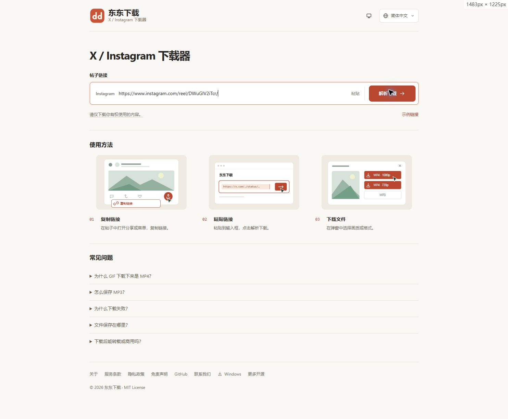

# 东东开源

开源项目展示页，在线访问 **[dd-oss.com](https://dd-oss.com/)**。

| 项目 | 说明 | 演示 / 源码 |
| --- | --- | --- |
| 东东下载 | X / Twitter、Instagram 视频与图片下载，支持 GIF 转换和 MP3 提取 | [在线使用](https://x.dd-oss.com/) · [源码](https://github.com/274335390/x-download) |
| StrideMetric | 离线鞋码换算、品牌尺码参考与个人档案 | [源码与运行说明](https://github.com/274335390/stride-metric) |

每个项目有独立仓库，按需下载即可。

## 维护首页

这是静态 HTML 网站，无需安装依赖。`index.html` 为项目内容，`style.css` 为样式，`assets/` 保存真实项目截图与图标。新增项目时补充对应卡片和截图，不需要复制项目源码到这个仓库。

页面支持浅色、深色和跟随系统，版权年份自动更新。

## 联系

使用反馈、功能建议或版权问题：[sddaspirine@gmail.com](mailto:sddaspirine@gmail.com)。

本站源码采用 [MIT](LICENSE) 许可证。各项目的代码、媒体和第三方组件许可请查看对应仓库。
